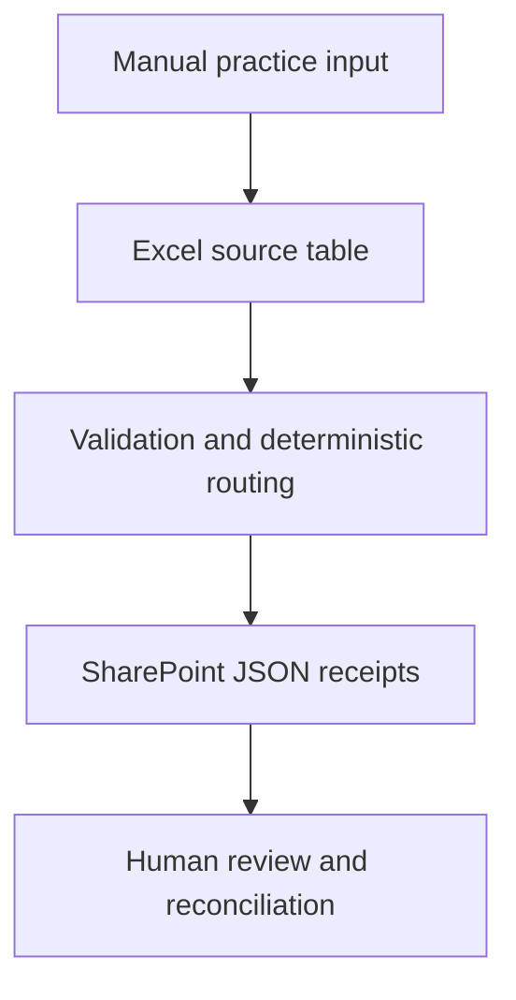

# Architecture

Route macro requests around the workflow server tool gate, require approval and publish a labeled sample artifact to a SharePoint folder.

M001 contains an excluded tool but remains eligible through the macro route. The published .txt artifact is deliberately not an executable Alteryx macro. No Alteryx platform publication or execution was performed.

The manual input schema and complete action graph are in `flow/`. Only standard SharePoint and Excel actions carry out service operations. There are no HTTP or email-send actions. Conditions and loop operations use Power Automate expressions.

Intake and certifier responses are separate records. Certification joins on RequestId + Revision, suppresses stale revisions, and flags duplicate or ambiguous records. A one-account practice environment does not prove that reviewers and submitters have separate permissions. A production solution needs explicit access design, ownership, retention, error handling and a transaction-safe uniqueness strategy.

The current import preserves the seed connection configuration as invoker connections: the runner supplies authorized SharePoint/Excel connections. Do not broaden access to make a demo run.
