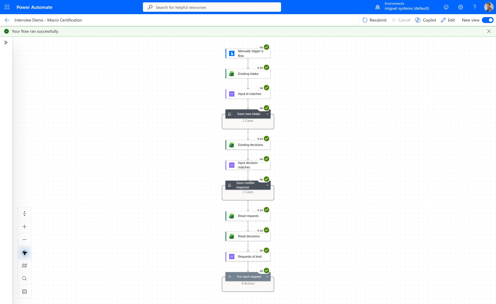

# Validation record

Test date: November 17, 2026, America/Chicago (November 18 UTC). Synthetic private tenant practice.

- Native package import: successful.
- Baseline flow run: **Succeeded**.
- Run identifier: `08584066440000237418287310326CU24`.
- Real emails: **0**.
- Native output reconciliation: see `validation/baseline/`, `expected-baseline.json`, and `python3 scripts/verify_receipts.py`.
- Further checks: M001 Approved receipt and published sample artifact verified.

Actual Power Automate run trace, captured after the service reported success. File values are independently reconciled because successful execution alone does not prove correct business outcomes.

M001 contains an excluded tool but remains eligible through the macro route. The published .txt artifact is deliberately not an executable Alteryx macro. No Alteryx platform publication or execution was performed.

Local reference simulation separately passed 17 checks across the original suite. That result is not the native Microsoft run result. Native screenshots and JSON previews are separate evidence. The sanitized portable configuration has not been tested in a second tenant.
